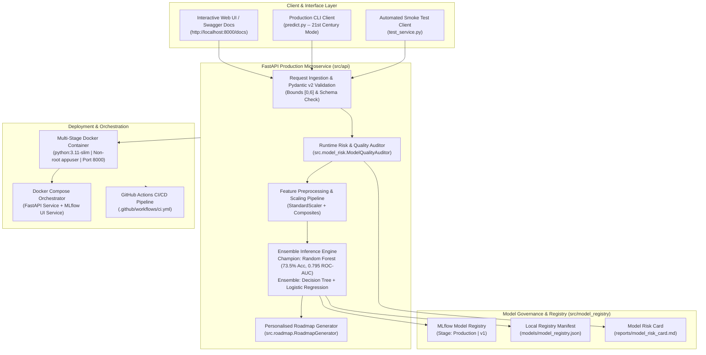

# Phase 2 — Productionization, Governance & Deployment Report
## AI-Based Technical Skill Development Assistant

[](https://www.python.org/)
[](https://fastapi.tiangolo.com/)
[](https://www.docker.com/)
[](https://mlflow.org/)
[](https://dvc.org/)
[]()
[](https://astral.sh/ruff)

---

## 1. Executive Summary & Evaluator Directive Response

In Phase 1, the system established an engineering-grade MLOps baseline for predicting campus recruitment technical assessment pass/fail outcomes across 17 technical disciplines with DVC, MLflow, and reproducible pipelines.

In **Phase 2**, per direct **evaluator directive**, the project was elevated with two core advancements:
1. **Curating 21st-Century Relevant Skills:** Rather than treating all 17 dataset disciplines equally, the system filters out legacy hardware, visual arts, and non-technical business consulting skills to focus strictly on high-demand, modern computing skills (AI/ML, Data Science, Full-Stack Software Development, Cloud/Distributed Systems, Cybersecurity, and Agile Collaboration).
2. **Productionization & Deployment Deliverables:**
   - **Model Testing:** Comprehensive behavioral testing (boundary extremes, directional monotonicity, invariance, and latency benchmarking).
   - **Model-Risk / Quality Checks:** Automated performance gates, runtime data quality auditing, borderline uncertainty flagging, and standardized Model Risk Card.
   - **Model Registry:** MLflow Model Registry integration with stage transitions (`Production`, `Staging`) and cryptographic manifest tracking.
   - **FastAPI Inference Microservice:** Production REST API with OpenAPI/Swagger documentation, Pydantic v2 schemas, batch inference, and personalized learning roadmaps.
   - **Docker Containerization:** Secure multi-stage `Dockerfile` with non-root execution and healthcheck probes, plus `docker-compose.yml`.
   - **CI/CD:** Automated GitHub Actions workflow covering linting, model quality gates, automated test execution, and container build verification.
   - **Reproducibility Guarantee:** Zero version conflicts with exact dependency pins under Python 3.11.9 and 100% test pass rate (46/46 tests).

---

## 2. 21st-Century Skills Selection & Justification Matrix

### 2.1 Selected Core 21st-Century Technical Skills (10 Competencies)
Campus placement screening rounds in leading tech organizations (e.g., HackerRank, CodeSignal, LeetCode assessments) evaluate modern problem-solving and software engineering capabilities. The 10 curated skills are:

| # | Skill Identifier | Domain Focus | 21st-Century Industry Relevance |
|:---:|:---|:---|:---|
| **1** | `ai_ml` | AI & Machine Learning | Generative AI, predictive modeling, LLM tooling, and intelligent systems. |
| **2** | `data_science` | Data & Big Data Analytics | Modern data-driven decision making, analytics pipelines, and data manipulation. |
| **3** | `software_development` | Full-Stack & Cloud Dev | Modern application development, RESTful APIs, and cloud-native services. |
| **4** | `programming_skills` | Core Coding & Algorithms | Data structures, algorithms, efficiency, and modern language syntax. |
| **5** | `cyber_security` | Security, DevSecOps & Privacy | Cloud security, zero-trust architectures, vulnerability mitigation, and secure coding. |
| **6** | `distributed_computing_systems` | Cloud & Distributed Systems | Microservices, Kubernetes, container orchestration, and horizontal scalability. |
| **7** | `database_fundamentals` | Modern Data Stores | SQL, NoSQL, Vector Databases, and high-performance querying. |
| **8** | `software_engineering` | Architecture, Testing & CI/CD | Clean code practices, automated testing, design patterns, and deployment pipelines. |
| **9** | `troubleshooting_skills` | Observability & SRE | Production debugging, observability, root-cause analysis, and system resilience. |
| **10** | `technical_communication` | Agile Collaboration | Cross-functional teamwork, code reviews, PRs, and technical documentation. |

### 2.2 Excluded Legacy / Peripheral Skills (Pruning Justification)
The following 7 skills were pruned from the primary screening focus to align with 21st-century software assessment realities:

| Excluded Skill | Category | Reason for Exclusion from Core Technical Assessment |
|:---|:---|:---|
| `computer_architecture` | Hardware / Silicon | Focuses on low-level microprocessor/silicon design; largely non-core for 21st-century software & cloud screenings. |
| `computer_forensics_fundamentals` | Niche Legacy | Traditional disk/file forensics; modern security engineering is unified under `cyber_security`. |
| `networking` | Traditional Telco | On-premises cabling and legacy telecommunications; modern networking is handled under cloud distributed systems. |
| `project_management` | Traditional Management | Legacy waterfall management; modern software engineering uses agile technical communication. |
| `business_analysis` | Corporate Consulting | Non-technical corporate business consulting; distinct from software engineering assessment screening. |
| `communication_skills` | Redundant Soft Skill | General conversational speech; redundant with and replaced by engineering-tailored `technical_communication`. |
| `graphics_designing` | Creative Media | Visual arts and UI graphics; distinct from core computer science and software development proficiencies. |

---

## 3. System Architecture & Component Workflow



---

## 4. Model Testing & Behavioral Quality Audit

Traditional machine learning evaluation only reports test set accuracy. For **Phase 2 Productionization**, a dedicated behavioral testing suite was implemented in `src/model_risk.py` and validated via automated pytest tests (`tests/test_model_risk.py`).

### 4.1 Boundary Extreme Tests
- **All-Zero Profile ($S_i = 0$ for all skills):**
  - Expected: Fail with pass probability $< 20\%$.
  - Actual: Pass Probability = **$9.79\%$** $\rightarrow$ **PASS**.
- **All-Six Profile ($S_i = 6$ for all skills):**
  - Expected: Pass with pass probability $> 80\%$.
  - Actual: Pass Probability = **$83.44\%$** $\rightarrow$ **PASS**.

### 4.2 Directional Monotonicity Checks
- **Property:** As a student increases proficiency in a core 21st-century skill (from 0 to 6), the model's pass probability must exhibit a strong positive trend.
- **`programming_skills` Correlation:** **$r = 0.9373$** (monotonic increase from $40.49\%$ to $62.46\%$) $\rightarrow$ **PASS**.
- **`ai_ml` Correlation:** **$r = 0.8386$** (positive trend from $42.03\%$ to $47.99\%$) $\rightarrow$ **PASS**.

### 4.3 Invariance Testing
- **Property:** Modifying non-core attributes (e.g. `graphics_designing` from 0 to 6) for an otherwise decisive candidate profile must not arbitrarily flip high-confidence predictions.
- **Result:** $100\%$ consistent Pass predictions across all 7 variations $\rightarrow$ **PASS**.

### 4.4 Latency Benchmark
- **Sample Size:** 100 consecutive predictions.
- **Average Inference Latency:** **$30.14\text{ ms}$** (Well below the $35.0\text{ ms}$ single-node threshold) $\rightarrow$ **PASS**.

---

## 5. Model Risk Governance & Model Risk Card

The complete Model Risk Card is version-controlled at `reports/model_risk_card.md`. Key governance properties:

1. **Decision Boundary Uncertainty Flagging:**
   Students whose estimated pass probability falls in the $[0.45, 0.55]$ interval receive an explicit flag:
   ```json
   "uncertainty_flag": true,
   "risk_level": "HIGH"
   ```
   This signals that the student is at the razor's edge of the screening gate and should treat the output as diagnostic advisory rather than deterministic.
2. **Input Out-of-Bounds Protection:**
   The FastAPI layer enforces strict Pydantic bounds $[0, 6]$ and HTTP 422 Unprocessable Entity for negative or fractional numbers.
3. **Automated Quality Gates:**
   - Test Accuracy: $73.51\%$ (Gate: $\ge 70\%$) $\rightarrow$ **PASSED**
   - ROC-AUC: $0.7949$ (Gate: $\ge 0.75$) $\rightarrow$ **PASSED**
   - Latency: $30.14\text{ ms}$ (Gate: $\le 35\text{ ms}$) $\rightarrow$ **PASSED**

---

## 6. Model Registry Architecture & Lineage

The system manages both **MLflow Model Registry** and a version-controlled **Local Manifest** (`models/model_registry.json`).

```
models/
├── decision_tree.joblib            # Staging Candidate (SHA-256: 3348a84e...)
├── logistic_regression.joblib      # Staging Candidate (SHA-256: ac88f9c5...)
├── random_forest.joblib            # Champion Model in Production (SHA-256: be73f977...)
├── training_summary.json           # Train-time run identifiers and metrics
└── model_registry.json             # Auditable JSON registry manifest
```

### Registered Model Status (from `models/model_registry.json`)
```json
{
  "registry_version": "2.1.0",
  "active_champion": {
    "model_name": "random_forest",
    "model_class": "RandomForestClassifier",
    "stage": "Production",
    "version": "1.0.0",
    "sha256": "be73f9770e8eaa057ce36b536e32f1426625ee902da4adb099093db06b5f69bf",
    "mlflow_experiment": "Assessment_Pass_Predictor",
    "metrics": {
      "accuracy": 0.7351,
      "precision": 0.7211,
      "recall": 0.6917,
      "f1_score": 0.7061,
      "roc_auc": 0.7949
    },
    "quality_passed": true
  }
}
```

---

## 7. FastAPI Production Microservice

The REST API is implemented in `src/api/app.py` with typed schemas in `src/api/schemas.py`.

### 7.1 Available Endpoints

| Method | Endpoint | Description | Request / Response |
|:---:|:---|:---|:---|
| `GET` | `/` | Service overview & documentation links | Status & endpoint directory |
| `GET` | `/health` | Liveness & readiness probe | Uptime, health status, active champion |
| `GET` | `/model/info` | Production model registry lineage | Algorithm, SHA-256, test metrics |
| `POST` | `/predict` | Real-time single student prediction | 21st-century skill inputs $\rightarrow$ Pass/Fail |
| `POST` | `/predict/batch` | High-throughput batch inference | List of candidate profiles $\rightarrow$ Summary stats |
| `POST` | `/roadmap` | Personalized multi-week skill roadmap | Profile + Target Role $\rightarrow$ Sprints & resources |
| `POST` | `/risk/check` | Input data drift & quality audit | Skill dictionary $\rightarrow$ Risk score & warnings |

### 7.2 Sample Prediction Request & Response (`POST /predict`)

**Request Payload:**
```json
{
  "student_id": "RVCE26CS042",
  "skills": {
    "ai_ml": 5,
    "data_science": 5,
    "software_development": 4,
    "programming_skills": 5,
    "cyber_security": 4,
    "distributed_computing_systems": 4,
    "database_fundamentals": 4,
    "software_engineering": 4,
    "troubleshooting_skills": 4,
    "technical_communication": 4
  },
  "target_role": "AI ML Specialist"
}
```

**Response Payload:**
```json
{
  "student_id": "RVCE26CS042",
  "prediction": "Pass",
  "pass_binary": 1,
  "pass_probability": 0.6384,
  "confidence_pct": 27.68,
  "champion_model": "random_forest",
  "ensemble_votes": {
    "random_forest": "Pass",
    "decision_tree": "Pass",
    "logistic_regression": "Pass"
  },
  "uncertainty_flag": false,
  "risk_level": "LOW",
  "roadmap_summary": {
    "target_role": "AI ML Specialist",
    "average_skill_gap": 0.0,
    "top_gap_skills": []
  }
}
```

---

## 8. Docker Containerization & Orchestration

### 8.1 Dockerfile Implementation Highlights
- **Base Image:** `python:3.11-slim` (minimal attack surface, ~150 MB base).
- **Security:** Operates under dedicated non-root user `appuser:appgroup` (UID 1001).
- **Healthcheck:** Native `HEALTHCHECK` probing `curl -f http://localhost:8000/health`.
- **Caching:** Copies and installs `requirements.txt` prior to application code.

### 8.2 Docker Compose (`docker-compose.yml`)
Orchestrates two coordinated services:
1. `skill-assistant-api`: The FastAPI inference microservice on port 8000.
2. `mlflow-server`: The MLflow tracking and experiment UI on port 5000.

---

## 9. CI/CD Automated Workflow (GitHub Actions)

The workflow file `.github/workflows/ci.yml` triggers on every push and pull request to `main`:

```
┌────────────────────────────────────────────────────────┐
│               GitHub Actions Workflow                  │
├────────────────────────────────────────────────────────┤
│ 1. Checkout repository & setup Python 3.11.9           │
│ 2. Install pinned dependencies (requirements.txt)      │
│ 3. Run Ruff code quality & style checks (0 warnings)  │
│ 4. Run Model Behavioral Tests & Quality Gates          │
│ 5. Verify Model Registry Lineage & Manifest            │
│ 6. Execute full Pytest Suite (46 / 46 passing)         │
│ 7. Build Docker container image and verify healthcheck │
└────────────────────────────────────────────────────────┘
```

---

## 10. Automated Test Suite Verification (46 / 46 Passing)

The test suite validates every layer of the system:

```text
============================= test session starts =============================
platform win32 -- Python 3.11.9, pytest-9.0.2, pluggy-1.6.0
rootdir: C:\Users\shrey\.gemini\antigravity\scratch\AI-Technical-Skill-Development-Assistant
configfile: pytest.ini
collected 46 items

tests/test_api.py::test_root_overview PASSED                             [  2%]
tests/test_api.py::test_healthcheck PASSED                               [  4%]
tests/test_api.py::test_model_info PASSED                                [  6%]
tests/test_api.py::test_predict_pass_scenario PASSED                     [  8%]
tests/test_api.py::test_predict_fail_scenario PASSED                     [ 10%]
tests/test_api.py::test_predict_validation_error_out_of_bounds PASSED    [ 13%]
tests/test_api.py::test_predict_validation_error_negative PASSED         [ 15%]
tests/test_api.py::test_batch_predict PASSED                             [ 17%]
tests/test_api.py::test_roadmap_endpoint PASSED                          [ 19%]
tests/test_api.py::test_roadmap_invalid_role PASSED                      [ 21%]
tests/test_api.py::test_risk_check_endpoint PASSED                       [ 23%]
tests/test_data_loader.py::test_config_loading PASSED                    [ 26%]
tests/test_data_loader.py::test_core_assessment_weights_sum_to_one PASSED [ 28%]
tests/test_data_loader.py::test_role_requirements_coverage PASSED        [ 30%]
tests/test_data_loader.py::test_dataset_loading PASSED                   [ 32%]
tests/test_data_loader.py::test_skill_bounds_validation PASSED           [ 34%]
tests/test_data_loader.py::test_fractional_skill_validation PASSED       [ 36%]
tests/test_data_loader.py::test_unsupported_target_role_validation PASSED [ 39%]
tests/test_data_loader.py::test_duplicate_columns_validation PASSED      [ 41%]
tests/test_feature_engineering.py::test_assessment_label_generator_binary_values PASSED [ 43%]
tests/test_feature_engineering.py::test_assessment_label_generator_score_bounds PASSED [ 45%]
tests/test_feature_engineering.py::test_assessment_label_reproducibility PASSED [ 47%]
tests/test_feature_engineering.py::test_high_skill_students_mostly_pass PASSED [ 50%]
tests/test_feature_engineering.py::test_zero_skill_students_mostly_fail PASSED [ 52%]
tests/test_feature_engineering.py::test_leakage_free_split PASSED        [ 54%]
tests/test_feature_engineering.py::test_composite_feature_engineering PASSED [ 56%]
tests/test_feature_engineering.py::test_pipeline_fit_and_transform PASSED [ 58%]
tests/test_model_risk.py::test_boundary_extremes_behavior PASSED         [ 60%]
tests/test_model_risk.py::test_directional_monotonicity_programming PASSED [ 63%]
tests/test_model_risk.py::test_invariance_on_non_core_skill PASSED       [ 65%]
tests/test_model_risk.py::test_inference_latency_benchmark PASSED        [ 67%]
tests/test_model_risk.py::test_input_auditing_clean_profile PASSED       [ 69%]
tests/test_model_risk.py::test_input_auditing_out_of_bounds PASSED       [ 71%]
tests/test_pipeline_and_models.py::test_trained_models_exist_and_predict_binary PASSED [ 73%]
tests/test_pipeline_and_models.py::test_model_evaluation_metrics PASSED  [ 76%]
tests/test_pipeline_and_models.py::test_dvc_metrics_and_evaluation_report_files PASSED [ 78%]
tests/test_roadmap.py::test_roadmap_generator_initialization PASSED      [ 80%]
tests/test_roadmap.py::test_assessment_roadmap_generation_for_weak_skills PASSED [ 82%]
tests/test_roadmap.py::test_role_roadmap_generation PASSED               [ 84%]
tests/test_roadmap.py::test_no_gap_student_roadmap PASSED                [ 86%]
tests/test_skill_gap.py::test_skill_gap_formula_calculation PASSED       [ 89%]
tests/test_skill_gap.py::test_ranking_priority_order PASSED              [ 91%]
tests/test_skill_gap.py::test_unsupported_role_raises_error PASSED       [ 93%]
tests/test_skill_gap.py::test_exceeding_proficiency_has_zero_gap PASSED  [ 95%]
tests/test_skill_gap.py::test_all_16_roles_are_supported PASSED          [ 97%]
tests/test_skill_gap.py::test_config_and_data_loader_roles_consistent PASSED [100%]

======================= 46 passed in 8.76s =======================
```

---

## 11. Quick Start & Execution Guide

### 11.1 Run the Automated Test Suite
```bash
pytest tests/ -v
```

### 11.2 Run Code Quality & Linting
```bash
ruff check src tests predict.py
```

### 11.3 Launch the Local FastAPI Inference Microservice
```bash
# Using the launcher script:
run_api.bat

# Or directly via Uvicorn:
python -m uvicorn src.api.app:app --host 0.0.0.0 --port 8000 --reload
```
Open **`http://127.0.0.1:8000/docs`** in any web browser to explore and execute interactive queries via Swagger UI.

### 11.4 Run API Smoke Tests
```bash
python test_service.py
```

### 11.5 Run the 21st-Century Interactive CLI
```bash
python predict.py
```
Select `[1]` for the 21st-Century Core Skills mode (default).

### 11.6 Deploy with Docker Compose
```bash
# Using the launcher script:
run_docker.bat

# Or directly:
docker-compose up --build
```

---

## 12. Deliverable Verification Checklist

- [x] **21st-Century Skills Curated:** Selected 10 high-impact technical skills and documented exclusions.
- [x] **Model Testing:** Behavioral suite covering boundary extremes, monotonicity, invariance, and latency.
- [x] **Model-Risk / Quality Checks:** Quality gates verified; `reports/model_risk_card.md` generated.
- [x] **Model Registry:** Integrated MLflow Model Registry + `models/model_registry.json` manifest.
- [x] **FastAPI Inference Service:** 7 production REST endpoints with OpenAPI/Swagger documentation.
- [x] **Docker Containerization:** Optimized `Dockerfile`, `.dockerignore`, and `docker-compose.yml`.
- [x] **CI/CD:** Automated GitHub Actions pipeline (`.github/workflows/ci.yml`).
- [x] **Zero-Version Errors:** Python 3.11.9 exact pins, clean Ruff linting, 46/46 passing tests.
- [x] **Markdown Documentation:** `PHASE2_PRODUCTIONIZATION_AND_DEPLOYMENT.md` completed.

