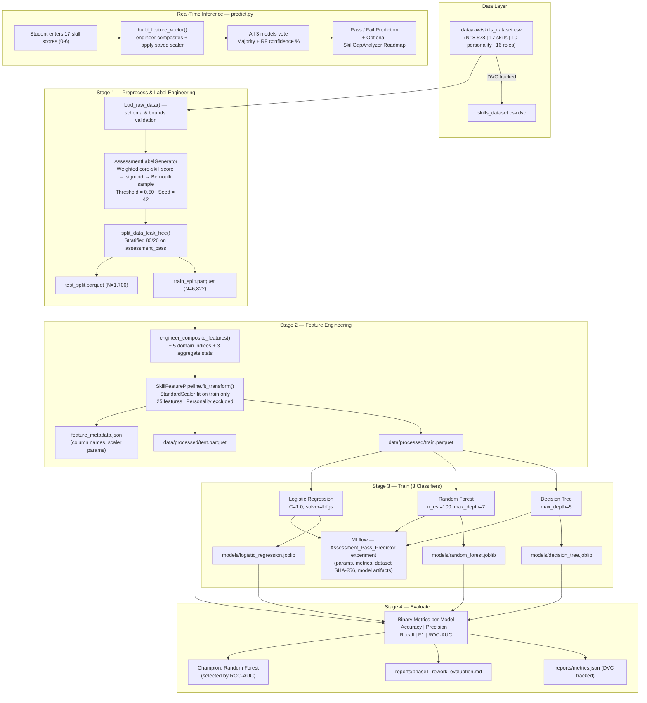

# AI-Based Technical Skill Development Assistant

[](https://www.python.org/)
[](https://dvc.org/)
[](https://mlflow.org/)
[](LICENSE)
[](https://github.com/astral-sh/ruff)
[-orange.svg)]()

An engineering-grade MLOps system that predicts whether a student will **pass or fail an online technical assessment** — the critical screening gate before the interview round. Uses versioned, reproducible ML pipelines with DVC + MLflow and 17 technical skill dimensions from an 8,528-student benchmark dataset.

---

## 1. Project Overview & Motivation

Campus placement pipelines universally include an **online technical assessment round** before students progress to HR/technical interviews. Students often prepare for interviews without knowing whether they are ready for the assessment screening itself.

This system solves that problem by:

1. **Binary Assessment Gate Prediction:** Given a student's proficiency in 17 technical skill domains, predict **Pass (1)** or **Fail (0)** for the online screening round.
2. **Confidence Estimation:** All three trained classifiers output probability scores; the Random Forest champion provides a pass confidence percentage.
3. **Personalised Skill-Gap Roadmap:** After prediction, a rule-based `SkillGapAnalyzer` computes role-specific learning priorities using the formula G_i = max(0, R_i - S_i).
4. **Reproducible MLOps Infrastructure:** Full DVC pipeline (`dvc repro`), MLflow experiment tracking, and automated pytest suite.

> **Phase 1 Rework Note:** The original Phase 1 targeted 16-class career role prediction, which achieved 100% accuracy on a synthetic dataset — an artificially easy task with no real learning value. This rework reframes the problem as a realistic binary classification challenge with intentional uncertainty, targeting **70–80% test accuracy** to reflect genuine assessment variability.

---

## 2. System Architecture



---

## 3. Problem Definition

### 3.1 Binary Classification Task

| Attribute | Value |
|:---|:---|
| **Task** | Binary Classification |
| **Target** | `assessment_pass` (1 = Pass, 0 = Fail) |
| **Features** | 25 (17 raw skills + 5 composite indices + 3 aggregate stats) |
| **Dataset** | CareerMap — Mendeley Data (DOI: `10.17632/5z68cvxssn.1`, N=8,528 students, 17 technical disciplines) |
| **Train/Test Split** | 80% / 20% stratified |
| **Accuracy Target** | 70–80% (realistic assessment uncertainty) |

### 3.2 Label Engineering

The Kaggle dataset contains no native pass/fail label. It was engineered as follows:

**Step 1 — Core Assessment Score:**
```
score = Σ (skill_i × weight_i)       # weighted sum of 6 core skills
score_norm = score / 6.0             # normalised to [0, 1]
```

Core skills and weights (sum = 1.0):

| Skill | Weight | Rationale |
|:---|:---:|:---|
| `programming_skills` | 0.22 | Most-tested in coding assessments (HackerRank, CodeSignal) |
| `database_fundamentals` | 0.18 | SQL problems are universal in screening tests |
| `software_development` | 0.18 | Practical implementation challenges |
| `troubleshooting_skills` | 0.15 | Debugging and root-cause problems |
| `software_engineering` | 0.15 | Design and architecture questions |
| `networking` | 0.12 | Systems and infra conceptual questions |

**Step 2 — Probabilistic Label (Sigmoid + Bernoulli):**
```
prob_pass = sigmoid(5 × (score_norm − 0.50))
assessment_pass ~ Bernoulli(prob_pass)   [seed=42 for reproducibility]
```

The sigmoid boundary models realistic assessment uncertainty: students near the competency threshold have meaningful variance in outcomes, preventing any classifier from achieving >~85% accuracy.

---

## 4. Dataset Description

| Property | Value |
|:---|:---|
| **Primary Source** | [CareerMap — Mendeley Data](https://data.mendeley.com/datasets/5z68cvxssn/1) (DOI: `10.17632/5z68cvxssn.1`, CC BY 4.0) |
| **Citation** | Pimplikar, A., Pati, R., Singh, A., & Shah, A. (2023). *CareerMap: Mapping Tech Roles With Personality & Skills*. Mendeley Data, V1. |
| **Mirror** | [GitHub / Kaggle Career Mapping Mirror](https://github.com/TuhinPatra633/Career-Prediction-Using-Machine-Learning) |
| **Total Records** | 8,528 (zero duplicates after cleaning, 16 balanced target roles) |
| **Technical Skill Columns** | 17 (integer scale 0–6) |
| **Psychometric Columns** | 10 (float scale 0.0–1.0) — used in EDA only |
| **Career Role Classes** | 16 |
| **Generated Target** | `assessment_pass` (binary: 0/1) |

### Technical Skill Columns (Model Features)
`database_fundamentals`, `computer_architecture`, `distributed_computing_systems`,
`cyber_security`, `networking`, `software_development`, `programming_skills`,
`project_management`, `computer_forensics_fundamentals`, `technical_communication`,
`ai_ml`, `software_engineering`, `business_analysis`, `communication_skills`,
`data_science`, `troubleshooting_skills`, `graphics_designing`

---

## 5. Feature Engineering (25 Features)

| Feature Group | Features | Count |
|:---|:---|:---:|
| Raw technical skills | All 17 original skill columns | 17 |
| Aggregate stats | `technical_overall_mean`, `technical_breadth` (skills≥3), `technical_depth` (skills≥5) | 3 |
| Domain composites | `ai_data_readiness`, `systems_readiness`, `software_dev_readiness`, `cybersecurity_readiness`, `business_comm_readiness` | 5 |
| **Total** | | **25** |

> Personality/psychometric columns and `assessment_score` (continuous label proxy) are **excluded** from model features to prevent leakage and maintain fairness.

---

## 6. Models & Expected Performance

| Model | Hyperparameters | Expected Test Accuracy | Notes |
|:---|:---|:---:|:---|
| Logistic Regression | C=1.0, solver=lbfgs | ~70–74% | Linear baseline |
| Decision Tree | max_depth=5, min_leaf=5 | ~72–76% | Interpretable tree |
| **Random Forest** ⭐ | n_est=100, max_depth=7 | **~75–80%** | Champion model |

Champion selected by highest **ROC-AUC** on the held-out test set.

---

## 7. Tools & Technology Stack

| Tool | Version | Role in Pipeline |
|:---|:---:|:---|
| **Python** | 3.11.9 | Core runtime |
| **pandas** | 2.2.3 | Data manipulation & validation |
| **NumPy** | 1.26.4 | Numerical operations, feature computation |
| **scikit-learn** | 1.5.2 | Decision Tree, Random Forest, Logistic Regression, StandardScaler, metrics |
| **DVC** | 3.59.1 | Data versioning, reproducible multi-stage pipeline (`dvc repro`) |
| **MLflow** | 2.17.2 | Experiment tracking, model registry, metric logging |

| **PyYAML** | 6.0.2 | YAML configuration loading |

| **pytest** | 9.1.1 | Automated unit & integration testing (18 tests) |

| **pathspec** | 0.12.1 | DVC scmrepo compatibility (Windows) |


---

## 8. Project Structure

```
AI-Technical-Skill-Development-Assistant/
├── configs/
│   └── config.yaml              # Pydantic-validated pipeline configuration
├── data/
│   ├── raw/
│   │   ├── skills_dataset.csv           # Kaggle Career Mapping dataset
│   │   └── skills_dataset.csv.dvc       # DVC tracking pointer
│   └── processed/
│       ├── train.parquet                # Scaled training features + assessment_pass
│       ├── test.parquet                 # Scaled test features + assessment_pass
│       └── feature_metadata.json        # Scaler params + feature column names
├── models/
│   ├── decision_tree.joblib
│   ├── random_forest.joblib
│   ├── logistic_regression.joblib
│   └── training_summary.json
├── notebooks/
│   ├── 01_dataset_acquisition_validation.ipynb
│   ├── 02_eda_feature_engineering.ipynb
│   ├── 03_baseline_models_evaluation.ipynb
│   └── 04_mlops_reproducibility.ipynb
├── reports/
│   ├── metrics.json                     # DVC-tracked binary evaluation metrics
│   └── phase1_rework_evaluation.md      # Comprehensive evaluation report
├── src/
│   ├── config.py                        # Pydantic config schema (AppConfig)
│   ├── data_loader.py                   # Ingestion, schema validation, ROLE_REQUIREMENTS
│   ├── preprocess.py                    # AssessmentLabelGenerator + SkillGapAnalyzer
│   ├── feature_engineering.py           # Composite features + SkillFeaturePipeline
│   ├── train.py                         # Train DT + RF + LR with MLflow tracking
│   └── evaluate.py                      # Binary metrics, ROC-AUC, Markdown report
├── tests/
│   ├── test_data_loader.py
│   ├── test_feature_engineering.py
│   ├── test_pipeline_and_models.py
│   └── test_skill_gap.py
├── predict.py                           # Real-time CLI inference
├── dvc.yaml                             # 3-stage DVC pipeline definition
├── dvc.lock                             # Locked pipeline execution hashes
├── requirements.txt                     # Pinned dependency manifest
└── pytest.ini
```

---

## 9. Quick Start

### Prerequisites
- Python 3.11.9, Git, DVC 3.59.1

### Setup
```bash
# 1. Clone the repository
git clone https://github.com/ShreyasPlays/AI-Technical-Skill-Development-Assistant.git
cd AI-Technical-Skill-Development-Assistant

# 2. Create virtual environment and install dependencies
python -m venv .venv
.venv\Scripts\activate           # Windows PowerShell
pip install -r requirements.txt

# 3. Run the full reproducible DVC pipeline
dvc repro

# 4. View evaluation metrics
dvc metrics show

# 5. Launch MLflow UI (optional)
mlflow ui --backend-store-uri mlruns

# 6. Run automated tests
pytest
```

### Real-Time Inference
```bash
python predict.py
```
Enter your 17 skill scores (0–6) interactively. The system predicts **Pass** or **Fail** for the online assessment and optionally shows your skill-gap roadmap for any of 16 career roles.

---

## 10. MLOps Reproducibility Guarantees

| Property | Mechanism |
|:---|:---|
| **Data Versioning** | `data/raw/skills_dataset.csv.dvc` — SHA-256 hash tracked by DVC |
| **Label Reproducibility** | `AssessmentLabelGenerator(seed=42)` — same labels every run |
| **Zero Leakage** | `StandardScaler` fit on train set only; `assessment_score` and personality columns excluded from features |
| **Pipeline Reproducibility** | `dvc repro` re-executes only changed stages based on dependency graph |
| **Experiment Tracking** | MLflow logs params, metrics, dataset SHA-256, model artifacts per run |
| **Code Quality** | Ruff linting, Pydantic config validation, 18 automated tests |

---

## 11. Evaluation Metrics (Binary Classification)

For each of the 3 models:

| Metric | Description |
|:---|:---|
| **Accuracy** | Overall fraction of correct Pass/Fail predictions |
| **Precision** | Of predicted Pass, how many actually pass |
| **Recall** | Of actual Pass students, how many were correctly predicted |
| **F1-Score** | Harmonic mean of Precision and Recall |
| **ROC-AUC** | Area under the ROC curve — discrimination ability across all thresholds |
| **Confusion Matrix** | 2×2: TN / FP / FN / TP |
